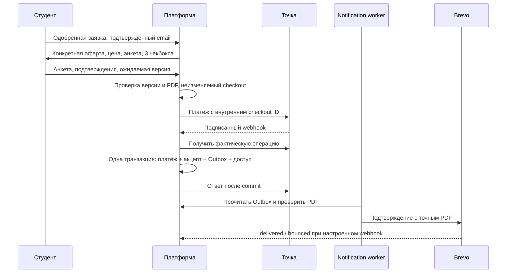

# Оферты, покупка программ и подтверждение договора

## Архитектура

Используются существующие `User`, `OpportunityPaymentAttempt`, Точка (`payments_with_receipt`),
`PaymentWebhookEvent`, проверка подписи RS256 и повторная проверка операции банком.
Новые платежные адаптеры, очередь или SMTP-клиент не вводятся. Оказание услуг запускается
существующими обработчиками `approve_opportunity_payment` / `approve_python_repeat_payment`.
Доставка работает в существующем ARQ `NotificationWorkerSettings` через Brevo
`CareerPackageEmailService`, расширенный необязательными вложениями, именем PDF и ключом
идемпотентности. Позднее импортируемые документы используют `PrivateMediaStore` и штатный S3.

| Продукт | Slug | Редакция | Публикация |
| --- | --- | --- | --- |
| `repeat_python_mentorship` | `repeat-python-mentorship` | `2026-09-02` | 02.09.2026 |
| `python_to_go_transition` | `python-to-go-transition` | `2026-09-03` | 03.09.2026 |

Финансовые данные берутся из серверной версии оферты: 3 000 000 копеек предоплаты, RUB,
100% расчетного ежемесячного вознаграждения дополнительно, без минимума, два платежа
через один и два календарных месяца. Эти условия сохраняются в снимке и не читаются
из браузера при обработке платежа. Данные Python-направления о вознаграждении ментору
сохраняются отдельно в существующем снимке заявки.

Исходные PDF и Markdown находятся в `backend/app/legal/documents` и автоматически входят
в runtime-образ через `COPY app`. Их байты не изменены. Имена объектов содержат SHA-256.
`manifest.json` фиксирует размер и хеш каждого документа. Тест содержит известные SHA-256
исходных PDF: изменение одновременно PDF и manifest не пройдёт незаметно.
Markdown сравнивается с извлечённым текстом PDF после удаления колонтитулов, пробелов
и разметки. PDF остаётся каноническим; checkout показывает PDF, а не переизложение текста.
Прежний публичный Python PDF оставлен для старых договорных ссылок.

## Модель и миграция

Миграция `20261016_0100` после `20261009_0099` создаёт семь таблиц:

- `legal_offer_versions`: продукт, редакция, публикация, начало действия, статус,
  ключи PDF/Markdown, SHA-256, MIME, размер, финансовые условия и даты смены статуса.
- `legal_checkouts`: пользователь, продукт, одобренная заявка, версия оферты,
  существующий платеж, срок действия, статус и полный снимок предварительных сведений.
- `contract_acceptances`: публичный номер, пользователь, продукт, checkout, платеж,
  оферта, время акцепта, время банка, время получения webhook, статус и SHA-256 снимка.
- `legal_email_deliveries`: одновременно транзакционный Outbox и журнал доставки:
  получатель, тема/тело, SHA-256 вложения, номер ручной попытки, автоматические retry,
  Message-ID, состояния и безопасные коды ошибок.
- `legal_email_verifications`: пользователь, конкретный email, хеш одноразового кода,
  срок 15 минут, число неуспешных попыток, время подтверждения.
- `legal_questionnaire_drafts`: редактируемый черновик анкеты пользователя по продукту.
- `legal_audit_events`: добавочные события пользователя, администратора и интеграций.

В `snapshot` checkout/договора находятся имя/email на момент подтверждения, точные тексты
трёх чекбоксов, boolean каждого, время каждого, версия формы, ответы и версия анкеты,
IP соединения, User-Agent, route/build, финансовые условия и SHA-256 PDF.
В договорный снимок дополнительно входят способ `PAYMENT`, сумма, валюта, провайдер,
идентификатор платежа и операции, даты оплаты/получения webhook.
Canonical JSON: UTF-8, отсортированные ключи, без лишних пробелов, SHA-256.

Уникальные ограничения защищают одну активную версию продукта, один pending checkout
заявки, один договор на checkout/платеж и одну первоначальную доставку договора.
Триггеры PostgreSQL запрещают изменение содержимого версии, checkout, акцепта и журнала
аудита и их удаление, включая bulk SQL. У checkout разрешена однократная привязка платежа;
у договора меняется только статус. ORM также защищает эти данные.
Это более строгое правило, чем запрет редактирования только уже использованной оферты:
содержимое draft тоже меняется созданием новой редакции.

Миграция регистрирует обе приложенные версии как active. PDF не помещается в SQL.
Старые акцепты не реконструируются задним числом. Старые ссылки на неоплаченные первоначальные
платежи не заменяют новый checkout: существующие endpoints теперь требуют анкету и подтверждения.
Rollback с существующими договорами запрещён. В production применяется только upgrade.

## Последовательность



Чекбокс, создание ссылки, возврат из банка, `AUTHORIZED`, `CREATED` и `PENDING` не создают
договор. Его создаёт только подтверждённый успешный платеж. При наличии достоверного
времени операции `Order[type=approval].time` используется оно; иначе время получения
успешного webhook. Оба значения различаются в записи. Даты хранятся в UTC; UI и письмо — МСК.

Подпись и факт операции проверяются существующим адаптером. Для legal-покупок дополнительно
обязательны правильные checkout consumerId, operationId, сумма и валюта. Acquiring v1.0
не имеет параметра выбора валюты: адаптер сконфигурирован только на RUB. Если банк возвращает
явную валюту, она должна совпадать. В development fake webhook должен явно содержать currency.
Пример поля operation time и статусов см. [документацию Точки](https://developers.tochka.com/docs/tochka-api/api/get-payment-operation-info-acquiring-v-1-0-payments-operation-id-get).

`retired` запрещает новые checkout; существующие сессии могут завершиться в течение
24 часов с создания. `revoked`, отменённая и истёкшая сессия направляют позднюю оплату
на ручную проверку. Они не предоставляют доступ автоматически. Смена активной версии
не меняет оферту существующего checkout и договора.

Черновик сохраняется отдельно от снимка. Изменение черновика отменяет существующие pending
checkout этого продукта; следующий checkout создаёт новый снимок и платеж.
Внешняя банковская ссылка может оставаться доступной, поэтому поздняя оплата отменённой
сессии требует проверки команды. Нельзя считать локальную отмену банковским возвратом.

## Раздельные обязательства Python и Go

Миграция `20261017_0102` добавляет `student_payment_obligations` и привязку
`student_employments.obligation_id`. Первоначальное менторство и каждый принятый договор
перехода Go учитываются отдельно. Выплаты Python не уменьшают остаток Go; процент и
финансовый снимок Go берутся из конкретного `ContractAcceptance`, а не из текущего
`User.repayment_percent`. Вознаграждение по платежу рассчитывается с процентом его
обязательства. В графике ученик и сотрудник могут переключать договоры.

После полной выплаты Python его финансовый кейс при переходе Go получает статус
`completed`. Даты увольнения не добавляются, платежи и вознаграждения сохраняются.
Новая работа Go больше не блокируется полностью оплаченным Python. Отмена ошибочного
подтверждения старого платежа восстанавливает только остаток соответствующего договора.

Принятый договор Go автоматически привязывается к новой Go-работе. Перед начислением
сотрудник подтверждает применимость договора: новую профильную работу, дату и договорный
период. В форме квалификации это отдельный чекбокс; без него решение о профильности можно
сохранить, но начисления не создаются. Договорные даты не подставляются произвольно:
фиксированный конец контрольного периода в машинном финансовом снимке отсутствует,
поэтому применимость периода подтверждает сотрудник. В ручной форме сотрудника создание
графика также требует подтверждения условий договора. Отдельный вызов API создания
`EmploymentContractPolicySnapshot` для этого пути не нужен.

Полное новое обязательство Go составляет 100% подтвержденного вознаграждения: два платежа
по 50% через один и два календарных месяца, с точным распределением копеек. Повтор
подтверждения или webhook не добавляет обязательство либо график повторно. Новые оплаты
по неактивному договору блокируются. При смене Go-работы учитываются только выплаты
по тому же договору Go.

Перенос связывает прежние Go-кейсы только при совпадении направления и наличии договора,
принятого до создания кейса. Суммы, сроки, статусы платежей, договорные снимки и
вознаграждения перенос не пересчитывает. Старые кейсы без подтверждаемой привязки остаются
в первоначальном учёте; отсутствие акцепта не заменяется созданием договора задним числом.

## Email и документы

До первоначального платежа требуется подтверждение именно текущего email пользователя.
Адрес редактируется штатно на странице платежей; изменение адреса требует нового кода.
Код одноразовый, хранится в проверочной таблице только как salted SHA-256, действует
15 минут; максимум пять попыток, повторный запрос через 60 секунд. Письмо с кодом тоже
поступает в Outbox. Исторический email договора не меняется при правках профиля.

`deliver_legal_emails` запускается существующим notification-worker каждую минуту.
Строка очереди захватывается `FOR UPDATE SKIP LOCKED`, отправка производится вне банковской
транзакции, результат фиксируется отдельно. Стабильный Brevo `idempotencyKey` — ID строки
доставки. Ошибка почты не отменяет оплату, акцепт или доступ к программе.

После первой ошибки: повтор через 1 минуту, 5 минут, 30 минут, 2 часа, 12 часов.
После пяти повторов — failed и alert. Ручной resend создаёт новую строку попытки, сохраняет
старые строки и отправляет на первоначальный email. Cooldown по умолчанию 300 секунд,
одинаково для пользователя и администратора. Повтор webhook не создаёт повторный Outbox.

Тема, тело, получатель и SHA-256 вложения сохраняются до отправки. Шаблон один для двух
продуктов, включает публичный номер договора, редакцию, дату публикации, оплату и формулу,
дату акцепта в МСК и авторизованную ссылку `/documents?contract=…`.
Полная анкета, IP и User-Agent в письмо не включаются. Подписка на маркетинг не требуется.

Перед вложением и скачиванием файл проверяется по SHA-256. Проверяется также соответствие
продукту договора и SHA-256 самого договорного снимка. Нет публичных бессрочных токенов:
скачивание идёт через авторизованный API. PDF после смены редакции остаётся тем же.
Кассовые чеки по-прежнему отправляет существующая фискализация Точки, это отдельный процесс.

`sent` означает принятие провайдером, не достоверную доставку.
Для delivered/bounced настройте Brevo transactional webhook с Bearer authentication:
`POST /api/v1/legal/email/delivery-webhook`, token = `BREVO_DELIVERY_WEBHOOK_TOKEN`.
Сохраняется нормализованный Message-ID; повтор статуса безопасен.
См. [события Brevo](https://developers.brevo.com/docs/transactional-webhooks)
и [защиту webhook](https://developers.brevo.com/docs/secured-webhooks).

Brevo ограничивает срок идемпотентности 15 минут. DB-ограничения защищают от повторов
webhook/worker в обычном режиме; абсолютную exactly-once доставку при потере ответа API
и длительном простое внешняя система не гарантирует. Это ограничение провайдера необходимо
учитывать при разборе неопределённых результатов отправки.
[Описание idempotencyKey](https://developers.brevo.com/docs/heterogenous-versions-batch-emails).

## Интерфейс и права

Обе страницы программ используют `LegalCheckout`: цена, пример, ссылка на PDF, дата,
адрес документов, анкета и три выключенных по умолчанию чекбокса. Сумма, процент,
число платежей и редакция не принимаются как доверенные данные браузера.
На старую редакцию страницы backend отвечает conflict и просит ознакомление заново.

`/documents` доступен пользователю; в навигации — «Мои документы». Пользователь видит свои
договоры, дату/формулу/редакцию, неизменяемую анкету, историю доставки и действия PDF/resend.
Администратор видит «Договоры и оферты»: поиск по имени, email, номеру, продукту и платежу,
первоначальный/текущий email, полные снимки, audit, историю webhook, SHA-256,
редакции и их переключение, очередь и технические alerts. Доступ к чужому UUID — 404.
Роль `admin` соответствует существующей permission-модели платформы.
Кнопки удаления договора нет.

Возврат/прекращение/оспаривание фиксируются отдельным событием и изменением статуса.
История, accepted_at, PDF и письма сохраняются. Подтверждённые банковские REFUNDED,
REFUNDED_PARTIALLY и CHARGEBACK/DISPUTED записываются отдельно; частичный возврат
не помечает весь договор возвращённым. Ручная фиксация состояния имеет отдельный admin API.

Повторный Python использует существующие обязательства и два календарных платежа.
Новый Go использует существующий `PaymentInstallment` после квалификации нового
трудоустройства командой. Выбор снимка ограничен Go-track и новой записью трудоустройства,
созданной после акцепта. Старые Python employment/платежи не меняются. Рекуррентных
списаний нет; применимость результативного компонента по конкретному трудоустройству
по-прежнему требует штатной проверки команды.

## API

Все пути под `/api/v1`; действуют штатная авторизация и CSRF-защита браузерной сессии.

| Метод | Путь | Назначение |
| --- | --- | --- |
| GET | `/legal/products` | Каталог двух программ |
| GET | `/legal/products/{product}/checkout` | Активная версия, условия, тексты подтверждений, email |
| GET/PUT | `/legal/products/{product}/questionnaire` | Черновик анкеты |
| POST | `/opportunities/go-transition/{application_id}/payment-link` | Go: снимок и штатный платеж |
| POST | `/opportunities/python-repeat/applications/{application_id}/checkout` | Python: снимок и штатный платеж |
| GET | `/legal/checkouts/{id}` | Статус и снимок своего checkout |
| POST | `/legal/checkouts/{id}/cancel` | Отмена неоплаченной сессии |
| POST | `/legal/email/request-code` | Письмо с одноразовым кодом |
| POST | `/legal/email/confirm` | Подтвердить email |
| GET | `/legal/offers/{id}` | Метаданные редакции |
| GET | `/legal/offers/{id}/offer.pdf` | Проверенный PDF |
| GET | `/legal/contracts` | Собственные договоры |
| GET | `/legal/contracts/{id}` | Договор и история доставки |
| GET | `/legal/contracts/{id}/offer.pdf` | Точный PDF договора |
| POST | `/legal/contracts/{id}/resend-email` | Новая попытка отправки |
| GET | `/admin/legal/contracts?q=…` | Поиск договоров |
| GET/PATCH | `/admin/legal/offers[/{id}]` | Перечень/статус редакций |
| POST | `/admin/legal/contracts/{id}/state` | Возврат/спор/прекращение и audit |
| GET | `/admin/legal/metrics` | Счётчики, backlog и alerts |
| POST | `/payments/tochka/webhook` | Существующий банковский webhook |
| POST | `/legal/email/delivery-webhook` | Защищённый webhook Brevo |

Подробности/скачивание/resend администратор использует через те же object-authorized
методы `/legal/contracts/{id}`. Статус договора нельзя менять обычному пользователю.

## Импорт и запуск

В репозитории уже находятся обе исходные редакции. После миграции они активны.
Новая версия импортируется отдельно; ранее использованные ключи не перезаписываются.
CLI требует активного администратора для авторства audit. Идемпотентный импорт тех же
файлов возвращает существующую запись. Другие байты под тем же version code отвергаются.

Из каталога `backend`:

```sh
poetry run alembic upgrade head
poetry run python -m app.legal.cli verify-bundled

poetry run python -m app.legal.cli import \
  --admin-id "$ADMIN_ID" --product repeat_python_mentorship --version 2026-09-02 \
  --publication-date 2026-09-02 \
  --pdf "/path/to/Оферта_повторное_менторство_Python_30к_плюс_100процентов.pdf" \
  --markdown "/path/to/Оферта_повторное_менторство_Python_для_платформы.md"
poetry run python -m app.legal.cli activate \
  --admin-id "$ADMIN_ID" --product repeat_python_mentorship --version 2026-09-02

poetry run python -m app.legal.cli import \
  --admin-id "$ADMIN_ID" --product python_to_go_transition --version 2026-09-03 \
  --publication-date 2026-09-03 \
  --pdf "/path/to/Оферта_переход_Python_Go_30к_плюс_100процентов.pdf" \
  --markdown "/path/to/Оферта_переход_Python_Go_для_платформы.md"
poetry run python -m app.legal.cli activate \
  --admin-id "$ADMIN_ID" --product python_to_go_transition --version 2026-09-03

# Только проверка будущего импорта без записи: добавьте --dry-run.
poetry run arq app.notifications.jobs.NotificationWorkerSettings
```

Docker: `make docker-migrate`; production: `make prod-migrate`, затем штатный deploy.
Новые remote-файлы загружаются в штатный S3 bucket, с conditional write и проверкой хеша.
Резервное копирование должно охватывать базу и приватные объекты S3; исходные файлы
включены в репозиторий и образы приложения.

Переиспользуются `BREVO_API_KEY`, `BREVO_API_BASE_URL`, `BREVO_FROM_EMAIL`,
`BREVO_REPLY_TO_EMAIL`, `WEB_FRONTEND_URL`, штатные `S3_*`, `REDIS_URL`, `DATABASE_URL`.
Новые параметры в `.env.example` и `.env.production.example`:

| Переменная | По умолчанию |
| --- | --- |
| `LEGAL_EMAIL_FROM` | штатный `BREVO_FROM_EMAIL` |
| `LEGAL_EMAIL_REPLY_TO` | `BREVO_REPLY_TO_EMAIL`, затем официальный адрес |
| `CONTRACT_EMAIL_MAX_RETRIES` | 5 повторов после первоначальной попытки |
| `CONTRACT_EMAIL_RESEND_COOLDOWN_SECONDS` | 300 |
| `BREVO_DELIVERY_WEBHOOK_TOKEN` | выключен до настройки секрета |
| `TOCHKA_ACQUIRING_CURRENCY` | только RUB |

`APP_TIMEZONE` и новый bucket не добавляются: для договоров явно используется Europe/Moscow
и существующее приватное хранилище. Пустой webhook token отключает приём статусов.
Юридические email адреса валидируются, retry/cooldown ограничены конфигурацией.
Официальный адрес исполнителя хранится в одном месте — `Settings.legal_official_email`;
в шаблонах и compose-файлах он не дублируется.

## Наблюдаемость и разбор сбоев

Счётчики доступны в `/admin/legal/metrics`; вычисляются из сохранённых событий, поэтому
не сбрасываются с рестартом процесса. Среди них созданные акцепты, queued/sent/failed/bounced
письма, retry, hash mismatch, duplicate webhook и backlog. Вкладка администратора показывает
последние alerts. `monitor_legal_health` раз в 15 минут проверяет активные редакции,
доступность/хеш документов и письма, остающиеся в очереди дольше часа. Повтор одного
сигнала подавляется в течение часа; сообщение содержит технические идентификаторы.

- **Нет PDF / несовпадение SHA-256:** новый checkout и скачивание блокируются; отправка
  не прикладывает непроверенный файл. Восстановить исходные байты из резервной копии
  по сохранённому ключу. Не менять hash существующей версии. Проверить `verify-bundled`.
- **Нет active оферты:** проверить import/status/effective_from; активировать проверенную
  редакцию. Не выдавать вместо неё другой документ.
- **Успешный платеж без checkout, неверная сумма или валюта:** найти технический alert,
  банковскую операцию и исходный checkout. Не предоставлять доступ и не создавать
  фиктивный акцепт. Сверить платеж с банком; выполнить возврат либо отдельно оформить
  восстановление с аудитом. Платёж нельзя автоматически присвоить другому продукту.
- **Brevo недоступен:** договор и доступ сохраняются, письмо остаётся pending и повторяется.
  Исправить credentials/network, проверить notification-worker и статус очереди.
  После failed использовать ручной resend и проверить историю, учитывая неопределённость
  ранее потерянного ответа провайдера.
- **Bounce:** посмотреть безопасный код и первоначальный/текущий email в админке.
  Исторический адрес не переписывать. Пересылка через UI использует исходный адрес;
  направление на другой адрес требует отдельной согласованной процедуры с аудитом.
- **Доступ требует ручной проверки после успешной оплаты:** акцепт и письмо уже сохранены.
  Проверить наличие опубликованного track и применимость программы; исправить доступ
  штатными административными средствами, не создавать второй договор.

## Проверки и ручной сценарий

```sh
make lint
make format-python-check
make test
make typecheck
make format-frontend-check
python -m unittest discover -s scripts -p 'test_*.py'
cd backend && poetry run python -m app.legal.cli verify-bundled
```

Backend использует `mentoring_test`; альтернативный `TEST_DATABASE_URL` должен заканчиваться
на `_test`. Тест миграции помечен `schema_change`; SMTP и реальные банковские операции
в тестах не выполняются.

1. Выпускник Python подаёт заявку на повторный Python; администратор одобряет её.
   Студент открывает PDF редакции 02.09.2026, подтверждает email, заполняет сведения,
   отмечает три пункта и создаёт платеж. До оплаты договора нет.
2. Аналогично проверить переход Python → Go с редакцией 03.09.2026.
3. Отправить успешный webhook; после commit проверить один договор, доступ к программе,
   pending письмо и исходный email в `/documents`. Сверить SHA-256 скачанного PDF.
4. Повторить webhook, в том числе с другим event ID той же успешной операции:
   договор и первоначальное письмо остаются единственными.
5. Подменить fake Brevo ответ на ошибку: договор и доступ сохраняются; pending/retry
   переходит в failed после лимита. Восстановить provider и выполнить resend после cooldown.
6. Проверить delivered/bounce с корректным и некорректным Bearer token.
7. Активировать новую редакцию: новый checkout использует её, старый договор скачивает
   исходный PDF. Проверить устаревшую открытую страницу и conflict при создании checkout.
8. Проверить чужой contract UUID, пользовательский вызов admin API и audit admin resend.
9. Зафиксировать возврат/chargeback: accepted_at, история писем и исходный PDF сохраняются.

Фактические результаты запуска проверок и перечень изменённых файлов см.
`docs/legal-offers-implementation-report.md`.
